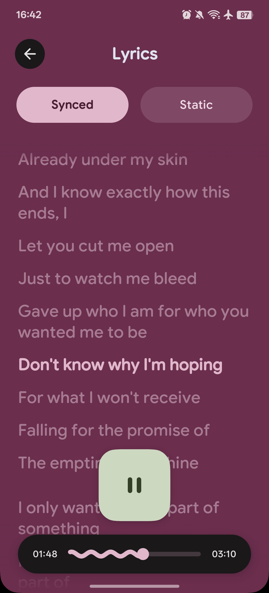

# 像素播放器 🎵

**🌐 语言 / Languages / 言語 / Языки / Idiomas**

[**简体中文**](README.md) · [English](README_en.md) · [日本語](README_ja.md) · [Русский](README_ru.md) · [Español](README_es.md)

**基于 [PixelPlayer](https://github.com/theovilardo/PixelPlayer/) 的魔改版**

多平台在线音源 · 专为中国用户打磨 · 像素美学与精致动效

---

## 🖼️ 界面预览

  
  &nbsp;
  
  &nbsp;
  
  &nbsp;
  

---

## 📖 目录

- [✨ 功能亮点](#-功能亮点)
- [📱 设备要求](#-设备要求)
- [⬇️ 下载](#️-下载)
- [📚 相关文档](#-相关文档)
- [❤️ 捐赠](#️-捐赠)
- [📄 许可证](#-许可证)
- [☎️ 联系我们](#️-联系我们)

> **兼容性提示**：Android 9 及以上可保障正常使用；Android 7 / 8 不保证稳定性；Android 12 及以上才能获得完整的模糊效果。

---

## ✨ 功能亮点

### 🎨 现代化 UI/UX

- Material You：基于壁纸的动态配色
- 流畅动画：平滑的过渡与微交互
- 可定制界面：可调圆角、导航栏样式与紧凑模式
- 深色 / 浅色主题：自动或手动切换
- 专辑封面色彩提取：动态主题色
- **应用字体设置**：全局界面字体可自由更换 —— 内置字体、[像素字体市场](https://github.com/zispace/hanzi-fonts)按需下载（MiSans / 思源 / 阿里普惠体等开源与免费商用字体）、或导入自己的 `.ttf/.otf` 字体文件；歌词字体独立设置互不影响
- 多语言支持：中文、英语、德语、西班牙语、法语、印尼语、意大利语、韩语、挪威语、俄语、土耳其语共 11 种

### 🎵 强大的播放能力

- Media3 ExoPlayer + FFmpeg：专业音频引擎
- miniaudio 集成：通过 JNI 支持高保真格式的 C/C++ 解码器
- DSD/DFF 支持：原生 DSD64/DFF 播放并带自定义转码引擎
- USB DAC 输出：支持外置 USB DAC 获得发烧级音质
- 后台播放：完整的媒体会话集成
- 播放队列管理：支持拖拽重排
- 随机 & 循环：支持所有播放模式
- 无缝播放（Gapless）：曲目间平滑过渡
- 自定义过渡：可配置歌曲间的交叉淡入淡出
- ReplayGain 支持：自动音量归一化

### 📚 媒体库管理

- 多格式支持：MP3、FLAC、AAC、OGG、WAV、ALAC、M4A、DSD/DFF 等
- 浏览方式：按歌曲、专辑、艺术家、流派、文件夹、播放列表浏览
- 智能艺术家解析：可配置多艺术家分隔符
- 专辑艺术家分组：正确组织专辑
- 文件夹过滤：选择要扫描的目录
- 标签编辑器：使用 TagLib 编辑元数据（支持 MP3、FLAC、M4A）

### ☁️ 云端服务集成

- QQ 音乐：可从 QQ 音乐账户流式播放
- 网易云音乐：访问网易云歌单，支持消息中心与「一起听」
- Bilibili：播放 B 站音频内容
- Jellyfin：完整的 Jellyfin 媒体服务器集成
- Navidrome / Subsonic：兼容 Subsonic 的服务器支持
- Telegram：从 Telegram 频道浏览并播放音乐
- 云端代理流媒体：基于代理的自适应质量流

### 🤖 AI 集成

- AI 播放列表生成：支持 Gemini、Deepseek、OpenAI、Groq、OpenRouter
- AI 元数据生成：自动生成元数据与描述
- AI 播放列表评估器：为生成的歌单给出质量评分
- 智能每日混音：基于听歌习惯的个性化推荐
- **AI 外接（MCP）**：内置 MCP 服务器，兼容客户端可配对后直接控制播放、检索曲库、创建歌单
- 使用分析：跟踪 AI token 使用并进行费用统计

### 🔍 发现与组织

- 全文搜索：跨库搜索并支持智能过滤
- 每日混音：AI 个性化播放列表
- 播放列表：拖拽管理自定义播放列表
- 统计：详细的听歌历史与习惯分析
- 智能播放列表：基于规则的自动生成
- 专注模式：番茄钟（学习 / 休息循环）

### 🎤 歌词

- 同步歌词：通过 LRCLIB API 与 Kugou 获取 LRC 格式
- 逐字歌词：支持 AMLL 逐字卡拉OK高亮
- RTL 歌词：阿拉伯语 / 希伯来语等歌词自动切换布局方向与对齐
- 歌词编辑：可修改或添加歌词
- 滚动显示：随音乐高亮当前歌词
- 翻译支持：同步翻译与罗马音显示
- 歌词字体：独立字体设置，支持多种可下载中文字体
- 歌词分享：生成精美分享卡片
- 本地歌词：从本地存储加载歌词

### 🎚️ 均衡器

- 系统均衡器：完整参数化 EQ 控制
- AutoEq 集成：基于耳机的自动均衡预设
- 自定义预设：保存并加载 EQ 配置
- 风格预设：摇滚、流行、古典等

### 🖼️ 艺术家图片

- Deezer 集成：自动获取艺术家图片
- 智能缓存：内存（LRU）+ 数据库缓存以支持离线
- 后备图标：当图片不可用时的美观占位
- 颜色提取：从专辑封面提取动态颜色

### 📲 多设备

- Chromecast：推流到电视或智能音响
- Android Auto：支持车载播放
- 小部件（Widgets）：Glance 桌面控件（4x1、4x2）
- 蓝牙：支持蓝牙音频设备
- Web 远程控制：通过 HTTP 服务在浏览器中控制播放

### 💾 备份与还原

- 完整备份：导出所有设置、播放列表与媒体库数据
- 选择性还原：选择需要还原的模块
- 云端备份：备份到各类云存储服务

### ⚙️ 高级功能

- 插件中心：QuickJS 沙盒插件（商店 / 本地导入 / 权限隔离 / 自带 UI 面板）
- 听歌识曲：录制外放声音识别歌曲
- 听力保护：耳机音量监测与超限提醒
- 批量操作：队列、多选、分享与喜欢的批量处理
- 格式转换器：音频格式转码（如 DFF→WAV）
- 队列分享：通过 M3U 文件分享播放列表
- 手势控制：基于手势的导航
- 开发者选项：为高级用户提供的高级设置

---

## 📱 设备要求

| 项目 | 要求 |
|------|------|
| **系统版本** | Android 9 (API 28) 或更高 |
| **运行内存** | 建议 6GB 及以上，体验更顺滑 |
| **USB OTG** | 用于 USB DAC 外接声卡 |

---

## ⬇️ 下载

### 从 GitHub Releases 获取最新安装包

| 版本 | 说明 | 分包 |
|:----:|------|------|
| **Full** | 完整版，含 Telegram 在线播放 | arm64-v8a / armeabi-v7a / x86_64 |
| **Lite** | 精简版，不含 Telegram 与 GMS（体积更小） | arm64-v8a / armeabi-v7a / x86_64 |

每个分包均附带 `.sha256` 校验文件；手机用户通常选择 **arm64-v8a** 即可。

 

更多平台安装包（Windows / TV 等）请前往官网获取

---

## 📚 相关文档

- 📋 [更新日志](CHANGELOG.md)
- ⚠️ [平台接口与稳定性风险说明](docs/reverse-api-risk-notes.md)
- 📦 [第三方开源组件许可](THIRD_PARTY_NOTICES.md)
- 🖥️ [桌面端 P1R2 架构选型决议](docs/desktop-p1r2-decisions.md)

---

## ❤️ 捐赠

你的每一笔捐赠，都能让我们做出更好玩、更有趣的功能。

**[点这里进入捐赠页面](https://pixel.grammx.asia/donate.html)**

---

## 📄 许可证

原项目 [许可证](LICENSE) · 本项目使用 **GPL_V3** 协议

---

## ☎️ 联系我们

QQ 群：[907852088](https://qm.qq.com/q/31XTTiZqg0)

  <b>像素播放器团队 制作 ❤️</b>
    
  <a href="https://github.com/r3n011">r3n_011</a> ·
  <a href="https://github.com/yzrbz">yzrbz</a> ·
  <a href="https://github.com/hzx0831">HZX0831</a>

