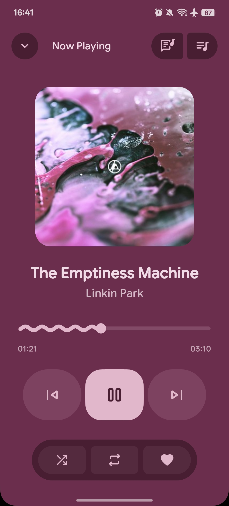

# Pixel Player 🎵

**Una bifurcación personalizada de [PixelPlayer](https://github.com/theovilardo/PixelPlayer/)**

Fuentes online multiplataforma · Pulido para usuarios chinos · Estética pixel con movimiento refinado

**🌐 语言 / Languages / 言語 / Языки / Idiomas**

[简体中文](README.md) · [繁體中文](README_zh-TW.md) · [English](README_en.md) · [日本語](README_ja.md) · [Русский](README_ru.md) · [**Español**](README_es.md)

---

## 🖼️ Capturas de pantalla

  
  &nbsp;
  
  &nbsp;
  
  &nbsp;
  

---

## 📖 Índice

- [✨ Características](#-características)
- [📱 Requisitos](#-requisitos)
- [⬇️ Descargas](#️-descargas)
- [📚 Documentación](#-documentación)
- [❤️ Donar](#️-donar)
- [📄 Licencia](#-licencia)
- [☎️ Contacto](#️-contacto)

> **Nota de compatibilidad**: Android 9 y versiones posteriores son totalmente compatibles; Android 7 / 8 no están garantizados; los efectos de desenfoque completos requieren Android 12 o superior.

---

## ✨ Características

### 🎨 Interfaz moderna (UI/UX)

- Material You: colores dinámicos basados en tu fondo de pantalla
- Animaciones fluidas: transiciones suaves y microinteracciones
- Interfaz personalizable: radio de las esquinas ajustable, estilo de la barra de navegación y modo compacto
- Tema oscuro / claro: automático o manual
- Extracción de colores de la portada: colores de acento dinámicos
- **Ajustes de fuente de la app**: cambia libremente la fuente global de la interfaz — fuentes integradas, descargas bajo demanda desde el [mercado de fuentes pixel](https://github.com/zispace/hanzi-fonts) (MiSans / Source Han / Alibaba PuHuiTi y otras fuentes de código abierto y de uso comercial gratuito), o importa tus propios archivos `.ttf/.otf`; la fuente de las letras se configura de forma independiente
- Localización: 11 idiomas — chino, inglés, alemán, español, francés, indonesio, italiano, coreano, noruego, ruso y turco

### 🎵 Reproducción

- Media3 ExoPlayer + FFmpeg: motor de audio profesional
- Integración de miniaudio: decodificadores en C/C++ para formatos de alta fidelidad mediante JNI
- Compatibilidad con DSD/DFF: reproducción nativa de DSD64/DFF con un motor de transcodificación propio
- Salida USB DAC: DAC USB externo para un sonido de calidad audiófila
- Reproducción en segundo plano: integración completa con la sesión multimedia
- Gestión de la cola: arrastra para reordenar
- Aleatorio y repetición: todos los modos de reproducción
- Reproducción sin pausas: transiciones perfectas entre pistas
- Transiciones personalizadas: fundido cruzado configurable entre pistas
- Compatibilidad con ReplayGain: normalización automática del volumen

### 📚 Gestión de la biblioteca

- Amplia compatibilidad de formatos: MP3, FLAC, AAC, OGG, WAV, ALAC, M4A, DSD/DFF y más
- Navega por canción, álbum, artista, género, carpeta o lista de reproducción
- Análisis inteligente de artistas: separadores de múltiples artistas configurables
- Agrupación por artista del álbum: organización correcta de los álbumes
- Filtrado de carpetas: elige qué directorios escanear
- Editor de etiquetas: edita metadatos con TagLib (MP3, FLAC, M4A)

### ☁️ Servicios en la nube

- QQ Music: reproduce en streaming desde tu cuenta de QQ Music
- NetEase Cloud Music: explora listas de reproducción, con centro de mensajes y Escuchar juntos
- Bilibili: reproduce contenido de audio de Bilibili
- Jellyfin: integración completa con el servidor multimedia Jellyfin
- Navidrome / Subsonic: compatibilidad con servidores compatibles con Subsonic
- Telegram: explora y reproduce música desde canales de Telegram
- Streaming mediante proxy en la nube: flujos de calidad adaptativa basados en proxy

### 🤖 Integración con IA

- Generación de listas de reproducción con IA: Gemini, Deepseek, OpenAI, Groq, OpenRouter
- Generación de metadatos con IA: metadatos y descripciones automáticos
- Evaluador de listas de reproducción con IA: puntuación de calidad para las listas generadas
- Mezcla diaria inteligente: recomendaciones personalizadas según tus hábitos de escucha
- **Puente de IA (MCP)**: servidor MCP integrado — los clientes compatibles pueden emparejarse y controlar directamente la reproducción, buscar en la biblioteca y crear listas de reproducción
- Análisis de uso: seguimiento del consumo de tokens de IA y de sus costes

### 🔍 Descubrimiento y organización

- Búsqueda de texto completo: búsqueda en toda la biblioteca con filtros inteligentes
- Mezcla diaria: listas de reproducción personalizadas por IA
- Listas de reproducción: gestión con arrastrar y soltar
- Estadísticas: historial y hábitos de escucha detallados
- Listas de reproducción inteligentes: generación automática basada en reglas
- Modo concentración: Pomodoro (ciclos de estudio / descanso)

### 🎤 Letras

- Letras sincronizadas: LRC desde la API de LRCLIB y Kugou
- Letras palabra por palabra: resaltado estilo karaoke de AMLL
- Letras RTL: dirección de composición y alineación automáticas para árabe / hebreo y más
- Edición de letras: modifica o añade letras
- Visualización con desplazamiento: la línea actual se resalta junto con la música
- Compatibilidad con traducciones: traducciones sincronizadas y romanización
- Fuente de las letras: ajustes de fuente independientes, varias fuentes CJK descargables
- Compartir letras: genera bonitas tarjetas para compartir
- Letras locales: carga letras desde el almacenamiento local

### 🎚️ Ecualizador

- Ecualizador del sistema: control EQ totalmente paramétrico
- Integración con AutoEq: preajustes automáticos según los auriculares
- Preajustes personalizados: guarda y carga configuraciones de EQ
- Preajustes por género: rock, pop, clásica y más

### 🖼️ Imágenes de artistas

- Integración con Deezer: imágenes de artistas automáticas
- Caché inteligente: caché en memoria (LRU) + base de datos para uso sin conexión
- Iconos de reserva: atractivos marcadores de posición cuando no hay imagen disponible
- Extracción de colores: colores dinámicos a partir de la portada del álbum

### 📲 Varios dispositivos

- Chromecast: envía a televisores y altavoces inteligentes
- Android Auto: reproducción en el coche
- Widgets: widgets de pantalla de inicio con Glance (4x1, 4x2)
- Bluetooth: dispositivos de audio Bluetooth
- Control remoto web: controla la reproducción desde un navegador mediante HTTP

### 💾 Copia de seguridad y restauración

- Copia de seguridad completa: exporta todos los ajustes, listas de reproducción y datos de la biblioteca
- Restauración selectiva: elige qué módulos restaurar
- Copia de seguridad en la nube: realiza copias en diversos servicios de almacenamiento en la nube

### ⚙️ Avanzado

- Centro de plugins: plugins en sandbox de QuickJS (tienda / importación local / aislamiento de permisos / paneles de UI integrados)
- Reconocimiento de canciones: identifica canciones grabando el audio del entorno
- Protección auditiva: monitorización del volumen de los auriculares y avisos de límite
- Operaciones por lotes: cola, selección múltiple, compartir y marcar como favorito en bloque
- Conversor de formatos: transcodificación de audio (p. ej. DFF→WAV)
- Compartir colas: comparte listas de reproducción mediante archivos M3U
- Control por gestos: navegación basada en gestos
- Opciones de desarrollador: ajustes avanzados para usuarios avanzados

---

## 📱 Requisitos

| Elemento | Requisito |
|------|-------------|
| **Versión del sistema** | Android 9 (API 28) o superior |
| **RAM** | Se recomienda 6 GB o más para la experiencia más fluida |
| **USB OTG** | Para la compatibilidad con DAC USB externos |

---

## ⬇️ Descargas

### Obtén las últimas compilaciones desde GitHub Releases

| Variante | Descripción | Arquitecturas |
|:-------:|-------------|--------|
| **Full** | Compilación completa con streaming de Telegram | arm64-v8a / armeabi-v7a / x86_64 |
| **Lite** | Compilación mínima sin Telegram ni GMS (más pequeña) | arm64-v8a / armeabi-v7a / x86_64 |

Cada variante incluye un archivo de suma de comprobación `.sha256`; la mayoría de los teléfonos deberían elegir **arm64-v8a**.

 

Las compilaciones para otras plataformas (Windows / TV, etc.) están disponibles en el sitio web oficial

---

## 📚 Documentación

- 📋 [Registro de cambios](CHANGELOG.md)
- ⚠️ [Notas sobre riesgos de estabilidad y API de plataformas](docs/reverse-api-risk-notes.md)
- 📦 [Avisos de componentes de código abierto de terceros](THIRD_PARTY_NOTICES.md)
- 🖥️ [Decisiones de arquitectura del escritorio P1R2](docs/desktop-p1r2-decisions.md)

---

## ❤️ Donar

Cada donación nos ayuda a crear funciones más divertidas e interesantes.

**[Haz clic aquí para donar](https://pixel.grammx.asia/donate.html)**

---

## 📄 Licencia

[Licencia](LICENSE) del proyecto original · Este proyecto se distribuye bajo **GPL_V3**

---

## ☎️ Contacto

Grupo QQ: [907852088](https://qm.qq.com/q/31XTTiZqg0)

  <b>Hecho con ❤️ por el equipo de Pixel Player</b>
    
  <a href="https://github.com/r3n011">r3n_011</a> ·
  <a href="https://github.com/yzrbz">yzrbz</a> ·
  <a href="https://github.com/hzx0831">HZX0831</a>

