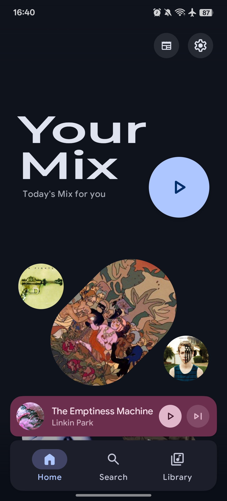

# PixelPlayer 🎵

**[PixelPlayer](https://github.com/theovilardo/PixelPlayer/) のカスタマイズ版**

マルチプラットフォームのオンライン音源 · 中国のユーザー向けに磨き上げ · ピクセル美学と洗練されたモーション

**🌐 言語 / Languages / 言語 / Языки / Idiomas**

[简体中文](README.md) · [繁體中文](README_zh-TW.md) · [English](README_en.md) · [**日本語**](README_ja.md) · [Русский](README_ru.md) · [Español](README_es.md)

---

## 🖼️ スクリーンショット

  
  &nbsp;
  
  &nbsp;
  
  &nbsp;
  

---

## 📖 目次

- [✨ 機能ハイライト](#-機能ハイライト)
- [📱 動作要件](#-動作要件)
- [⬇️ ダウンロード](#️-ダウンロード)
- [📚 ドキュメント](#-ドキュメント)
- [❤️ 支援する](#️-支援する)
- [📄 ライセンス](#-ライセンス)
- [☎️ お問い合わせ](#️-お問い合わせ)

> **互換性に関する注意**：Android 9 以上は完全にサポートしています。Android 7 / 8 は動作を保証しません。完全なブラー効果には Android 12 以上が必要です。

---

## ✨ 機能ハイライト

### 🎨 モダンな UI/UX

- Material You：壁紙に基づくダイナミックカラー
- 流れるようなアニメーション：滑らかな画面遷移とマイクロインタラクション
- カスタマイズ可能なインターフェース：角丸、ナビゲーションバーのスタイル、コンパクトモードを調整可能
- ダーク / ライトテーマ：自動または手動で切り替え
- アルバムアートの色抽出：ダイナミックなアクセントカラー
- **アプリのフォント設定**：グローバル UI フォントを自由に変更できます —— 内蔵フォント、[ピクセルフォントマーケット](https://github.com/zispace/hanzi-fonts)からのオンデマンドダウンロード（MiSans / Source Han / Alibaba PuHuiTi などのオープンソース・商用無料フォント）、または自作の `.ttf/.otf` ファイルのインポートにも対応。歌詞フォントは独立して設定できます
- 多言語対応：中国語、英語、ドイツ語、スペイン語、フランス語、インドネシア語、イタリア語、韓国語、ノルウェー語、ロシア語、トルコ語の 11 言語

### 🎵 再生機能

- Media3 ExoPlayer + FFmpeg：プロフェッショナルなオーディオエンジン
- miniaudio 統合：JNI 経由でハイファイフォーマットの C/C++ デコーダーを利用
- DSD/DFF 対応：独自のトランスコードエンジンによるネイティブ DSD64/DFF 再生
- USB DAC 出力：外付け USB DAC でオーディオファイル向けの高音質を実現
- バックグラウンド再生：メディアセッションを完全に統合
- 再生キュー管理：ドラッグ&ドロップで並べ替え
- シャッフル & リピート：すべての再生モードに対応
- ギャップレス再生：曲間をシームレスにつなぐ
- カスタムトランジション：曲間のクロスフェードを設定可能
- ReplayGain 対応：音量の自動正規化

### 📚 ライブラリ管理

- 幅広いフォーマットに対応：MP3、FLAC、AAC、OGG、WAV、ALAC、M4A、DSD/DFF など
- 曲、アルバム、アーティスト、ジャンル、フォルダ、プレイリストから閲覧
- スマートなアーティスト解析：複数アーティストの区切り文字を設定可能
- アルバムアーティストのグループ化：アルバムを正しく整理
- フォルダフィルタ：スキャン対象のディレクトリを選択
- タグエディタ：TagLib でメタデータを編集（MP3、FLAC、M4A）

### ☁️ クラウドサービス

- QQ Music：QQ Music アカウントからストリーミング再生
- NetEase Cloud Music：プレイリストを閲覧でき、メッセージセンターと「一緒に聴く」にも対応
- Bilibili：Bilibili のオーディオコンテンツを再生
- Jellyfin：Jellyfin メディアサーバーを完全統合
- Navidrome / Subsonic：Subsonic 互換サーバーに対応
- Telegram：Telegram チャンネルから音楽を閲覧・再生
- クラウドプロキシストリーミング：プロキシ経由のアダプティブ品質ストリーム

### 🤖 AI 統合

- AI プレイリスト生成：Gemini、Deepseek、OpenAI、Groq、OpenRouter に対応
- AI メタデータ生成：メタデータと説明文を自動生成
- AI プレイリスト評価：生成されたプレイリストを品質スコアリング
- スマートデイリーミックス：視聴履歴に基づくパーソナライズ推薦
- **AI ブリッジ（MCP）**：MCP サーバーを内蔵 —— 対応クライアントとペアリングすれば、再生の制御、ライブラリの検索、プレイリストの作成を直接実行できます
- 利用状況の分析：AI のトークン使用量とコストを追跡

### 🔍 発見と整理

- 全文検索：スマートフィルタ付きのライブラリ横断検索
- デイリーミックス：AI によるパーソナライズプレイリスト
- プレイリスト：ドラッグ&ドロップで管理
- 統計：詳細な視聴履歴と聴取傾向
- スマートプレイリスト：ルールベースの自動生成
- フォーカスモード：ポモドーロ（学習 / 休憩サイクル）

### 🎤 歌詞

- 同期歌詞：LRCLIB API と Kugou から LRC を取得
- 一文字ずつの歌詞：AMLL によるカラオケ風ハイライト
- RTL 歌詞：アラビア語 / ヘブライ語などのレイアウト方向と配置を自動調整
- 歌詞編集：歌詞の変更や追加が可能
- スクロール表示：再生に合わせて現在の行をハイライト
- 翻訳対応：同期翻訳とローマ字表記に対応
- 歌詞フォント：独立したフォント設定、ダウンロード可能な CJK フォントを多数用意
- 歌詞共有：美しい共有カードを生成
- ローカル歌詞：ローカルストレージから歌詞を読み込み

### 🎚️ イコライザー

- システムイコライザー：フルパラメトリック EQ 制御
- AutoEq 統合：ヘッドホンに基づく自動プリセット
- カスタムプリセット：EQ 設定の保存と読み込み
- ジャンル別プリセット：ロック、ポップ、クラシックなど

### 🖼️ アーティスト画像

- Deezer 統合：アーティスト画像を自動取得
- スマートキャッシュ：メモリ（LRU）+ データベースキャッシュでオフラインでも利用可能
- フォールバックアイコン：画像がない場合の美しいプレースホルダー
- 色抽出：アルバムアートからダイナミックカラーを取得

### 📲 マルチデバイス

- Chromecast：テレビやスマートスピーカーへキャスト
- Android Auto：車載での再生に対応
- ウィジェット：Glance によるホーム画面ウィジェット（4x1、4x2）
- Bluetooth：Bluetooth オーディオ機器に対応
- Web リモートコントロール：HTTP 経由でブラウザから再生を操作

### 💾 バックアップと復元

- 完全バックアップ：すべての設定、プレイリスト、ライブラリデータをエクスポート
- 選択的復元：復元するモジュールを選択可能
- クラウドバックアップ：各種クラウドストレージへバックアップ

### ⚙️ 高度な機能

- プラグインセンター：QuickJS サンドボックスプラグイン（ストア / ローカルインポート / 権限の分離 / 組み込み UI パネル）
- 曲名検索：周囲の音を録音して曲を識別
- 聴覚保護：ヘッドホン音量の監視と上限の通知
- 一括操作：キュー、複数選択、共有、お気に入りの一括処理
- フォーマット変換：オーディオのトランスコード（例：DFF→WAV）
- キューの共有：M3U ファイルでプレイリストを共有
- ジェスチャー操作：ジェスチャーによるナビゲーション
- 開発者向けオプション：パワーユーザー向けの詳細設定

---

## 📱 動作要件

| 項目 | 要件 |
|------|------|
| **OS バージョン** | Android 9（API 28）以上 |
| **RAM** | 6GB 以上を推奨（より滑らかな動作のため） |
| **USB OTG** | 外付け USB DAC の接続用 |

---

## ⬇️ ダウンロード

### GitHub Releases から最新ビルドを入手

| バリアント | 説明 | 分割 |
|:-------:|-------------|--------|
| **Full** | Telegram ストリーミングを含む完全版 | arm64-v8a / armeabi-v7a / x86_64 |
| **Lite** | Telegram と GMS を含まない最小構成版（より小容量） | arm64-v8a / armeabi-v7a / x86_64 |

各分割 APK には `.sha256` チェックサムファイルが付属します。ほとんどのスマートフォンでは **arm64-v8a** を選べば問題ありません。

 

その他のプラットフォーム向けビルド（Windows / TV など）は公式サイトで入手できます

---

## 📚 ドキュメント

- 📋 [変更履歴](CHANGELOG.md)
- ⚠️ [プラットフォーム API と安定性リスクに関する注意事項](docs/reverse-api-risk-notes.md)
- 📦 [サードパーティ製オープンソースのライセンス表示](THIRD_PARTY_NOTICES.md)
- 🖥️ [デスクトップ版 P1R2 のアーキテクチャ選定記録](docs/desktop-p1r2-decisions.md)

---

## ❤️ 支援する

皆さまからのご支援が、より楽しく面白い機能づくりの力になります。

**[こちらから寄付する](https://pixel.grammx.asia/donate.html)**

---

## 📄 ライセンス

オリジナルプロジェクトの[ライセンス](LICENSE) · 本プロジェクトは **GPL_V3** ライセンスで提供されています

---

## ☎️ お問い合わせ

QQ グループ：[907852088](https://qm.qq.com/q/31XTTiZqg0)

  <b>PixelPlayer チームが ❤️ を込めて制作</b>
    
  <a href="https://github.com/r3n011">r3n_011</a> ·
  <a href="https://github.com/yzrbz">yzrbz</a> ·
  <a href="https://github.com/hzx0831">HZX0831</a>

