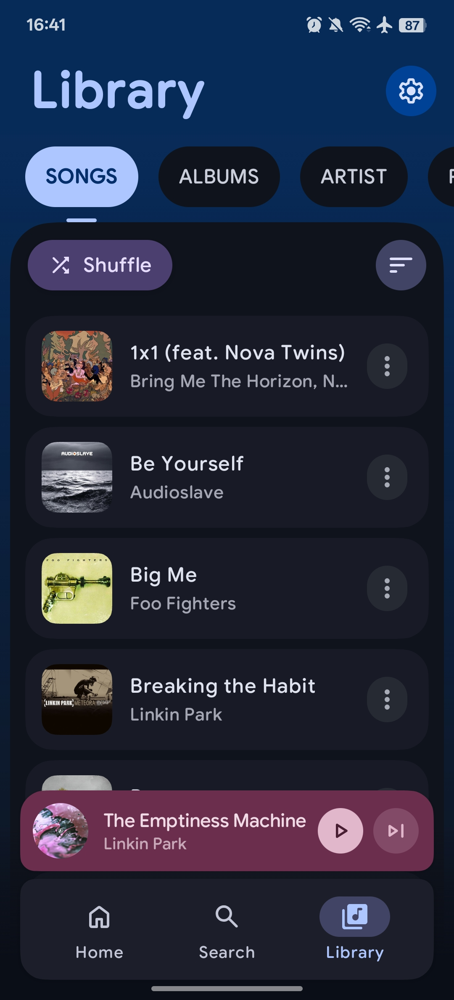

# Pixel Player 🎵

**Форк [PixelPlayer](https://github.com/theovilardo/PixelPlayer/) с доработками**

Мультиплатформенные онлайн-источники · Доработано для китайских пользователей · Пиксельная эстетика с отточенными анимациями

**🌐 语言 / Languages / 言語 / Языки / Idiomas**

[简体中文](README.md) · [繁體中文](README_zh-TW.md) · [English](README_en.md) · [日本語](README_ja.md) · [**Русский**](README_ru.md) · [Español](README_es.md)

---

## 🖼️ Скриншоты

  
  &nbsp;
  
  &nbsp;
  
  &nbsp;
  

---

## 📖 Содержание

- [✨ Возможности](#-возможности)
- [📱 Требования](#-требования)
- [⬇️ Загрузка](#️-загрузка)
- [📚 Документация](#-документация)
- [❤️ Пожертвовать](#️-пожертвовать)
- [📄 Лицензия](#-лицензия)
- [☎️ Контакты](#️-контакты)

> **Примечание о совместимости**: Android 9 и выше полностью поддерживаются; на Android 7 / 8 стабильность не гарантируется; полные эффекты размытия требуют Android 12+.

---

## ✨ Возможности

### 🎨 Современный UI/UX

- Material You: динамические цвета на основе ваших обоев
- Плавные анимации: мягкие переходы и микровзаимодействия
- Настраиваемый интерфейс: регулируемый радиус скругления, стиль панели навигации и компактный режим
- Тёмная / светлая тема: автоматически или вручную
- Извлечение цвета из обложки альбома: динамические акцентные цвета
- **Настройки шрифта приложения**: свободно меняйте глобальный шрифт интерфейса — встроенные шрифты, загрузка по запросу из [магазина пиксельных шрифтов](https://github.com/zispace/hanzi-fonts) (MiSans / Source Han / Alibaba PuHuiTi и другие открытые шрифты, свободные для коммерческого использования) или импорт собственных файлов `.ttf/.otf`; шрифт текстов песен настраивается отдельно
- Локализация: 11 языков — китайский, английский, немецкий, испанский, французский, индонезийский, итальянский, корейский, норвежский, русский, турецкий

### 🎵 Воспроизведение

- Media3 ExoPlayer + FFmpeg: профессиональный аудиодвижок
- Интеграция miniaudio: декодеры C/C++ для Hi-Fi форматов через JNI
- Поддержка DSD/DFF: нативное воспроизведение DSD64/DFF с собственным движком транскодирования
- Вывод на USB DAC: внешний USB DAC для звука аудиофильского уровня
- Фоновое воспроизведение: полная интеграция с медиасессией
- Управление очередью: перетаскивание для изменения порядка
- Случайный порядок и повтор: все режимы воспроизведения
- Воспроизведение без пауз (Gapless): бесшовные переходы между треками
- Настраиваемые переходы: настраиваемое перекрёстное затухание между треками
- Поддержка ReplayGain: автоматическая нормализация громкости

### 📚 Управление медиатекой

- Широкая поддержка форматов: MP3, FLAC, AAC, OGG, WAV, ALAC, M4A, DSD/DFF и другие
- Просмотр по песням, альбомам, исполнителям, жанрам, папкам или плейлистам
- Умный разбор исполнителей: настраиваемые разделители нескольких исполнителей
- Группировка по исполнителю альбома: правильная организация альбомов
- Фильтрация папок: выбор каталогов для сканирования
- Редактор тегов: редактирование метаданных с помощью TagLib (MP3, FLAC, M4A)

### ☁️ Облачные сервисы

- QQ Music: стриминг из вашего аккаунта QQ Music
- NetEase Cloud Music: просмотр плейлистов, центр сообщений и «Слушать вместе»
- Bilibili: воспроизведение аудиоконтента Bilibili
- Jellyfin: полная интеграция с медиасервером Jellyfin
- Navidrome / Subsonic: поддержка серверов, совместимых с Subsonic
- Telegram: просмотр и воспроизведение музыки из каналов Telegram
- Облачный прокси-стриминг: адаптивные по качеству потоки через прокси

### 🤖 Интеграция с AI

- Генерация плейлистов с помощью AI: Gemini, Deepseek, OpenAI, Groq, OpenRouter
- Генерация метаданных с помощью AI: автоматическое создание метаданных и описаний
- Оценщик плейлистов на базе AI: оценка качества сгенерированных плейлистов
- Умный ежедневный микс: персональные рекомендации на основе ваших привычек прослушивания
- **AI-мост (MCP)**: встроенный сервер MCP — совместимые клиенты могут подключиться и напрямую управлять воспроизведением, искать по медиатеке и создавать плейлисты
- Аналитика использования: отслеживание расхода токенов AI и затрат

### 🔍 Поиск и организация

- Полнотекстовый поиск: поиск по всей медиатеке с умными фильтрами
- Ежедневный микс: персональные плейлисты на базе AI
- Плейлисты: управление перетаскиванием
- Статистика: подробная история прослушивания и анализ привычек
- Умные плейлисты: автоматическая генерация по правилам
- Режим концентрации: Помодоро (циклы работы / отдыха)

### 🎤 Тексты песен

- Синхронизированные тексты: LRC из API LRCLIB и Kugou
- Пословные тексты: караоке-подсветка в стиле AMLL
- RTL-тексты: автоматическое направление вёрстки и выравнивание для арабского / иврита и других языков
- Редактирование текстов: изменение или добавление текстов песен
- Прокрутка: текущая строка подсвечивается вместе с музыкой
- Поддержка переводов: синхронизированные переводы и романизация
- Шрифт текстов песен: отдельные настройки шрифта, множество загружаемых шрифтов CJK
- Обмен текстами песен: создание красивых карточек для публикации
- Локальные тексты: загрузка текстов из локального хранилища

### 🎚️ Эквалайзер

- Системный эквалайзер: полный параметрический контроль EQ
- Интеграция AutoEq: автоматические пресеты под наушники
- Пользовательские пресеты: сохранение и загрузка конфигураций EQ
- Пресеты по жанрам: рок, поп, классика и другие

### 🖼️ Изображения исполнителей

- Интеграция Deezer: автоматическое получение изображений исполнителей
- Умное кеширование: кеш в памяти (LRU) + база данных для работы офлайн
- Резервные иконки: элегантные заглушки, когда изображение недоступно
- Извлечение цвета: динамические цвета из обложки альбома

### 📲 Работа с несколькими устройствами

- Chromecast: трансляция на телевизоры и умные колонки
- Android Auto: воспроизведение в автомобиле
- Виджеты: виджеты главного экрана Glance (4x1, 4x2)
- Bluetooth: Bluetooth-аудиоустройства
- Веб-пульт управления: управление воспроизведением из браузера через HTTP

### 💾 Резервное копирование и восстановление

- Полное резервное копирование: экспорт всех настроек, плейлистов и данных медиатеки
- Выборочное восстановление: выбор восстанавливаемых модулей
- Облачное резервное копирование: резервные копии в различных облачных хранилищах

### ⚙️ Дополнительно

- Центр плагинов: плагины в песочнице QuickJS (магазин / локальный импорт / изоляция разрешений / встроенные панели UI)
- Распознавание музыки: определение песни по записи окружающего звука
- Защита слуха: мониторинг громкости в наушниках и напоминания о превышении лимита
- Массовые операции: работа с очередью, множественный выбор, массовые публикация и добавление в избранное
- Конвертер форматов: транскодирование аудио (например, DFF→WAV)
- Обмен очередью: обмен плейлистами через файлы M3U
- Управление жестами: навигация с помощью жестов
- Параметры разработчика: расширенные настройки для опытных пользователей

---

## 📱 Требования

| Параметр | Требование |
|------|-------------|
| **Версия ОС** | Android 9 (API 28) или выше |
| **Оперативная память** | рекомендуется 6 ГБ и более для максимально плавной работы |
| **USB OTG** | для поддержки внешнего USB DAC |

---

## ⬇️ Загрузка

### Последние сборки доступны на GitHub Releases

| Вариант | Описание | Split-пакеты |
|:-------:|-------------|--------|
| **Full** | Полная сборка со стримингом Telegram | arm64-v8a / armeabi-v7a / x86_64 |
| **Lite** | Минимальная сборка без Telegram и GMS (меньше по размеру) | arm64-v8a / armeabi-v7a / x86_64 |

Каждый split-пакет поставляется с файлом контрольной суммы `.sha256`; большинству телефонов подойдёт **arm64-v8a**.

 

Сборки для других платформ (Windows / TV и т. д.) доступны на официальном сайте

---

## 📚 Документация

- 📋 [История изменений](CHANGELOG.md)
- ⚠️ [Замечания о платформенных API и рисках стабильности](docs/reverse-api-risk-notes.md)
- 📦 [Уведомления об открытом исходном коде третьих сторон](THIRD_PARTY_NOTICES.md)
- 🖥️ [Архитектурные решения для настольной версии P1R2](docs/desktop-p1r2-decisions.md)

---

## ❤️ Пожертвовать

Каждое пожертвование помогает нам создавать больше увлекательных и интересных функций.

**[Нажмите здесь, чтобы сделать пожертвование](https://pixel.grammx.asia/donate.html)**

---

## 📄 Лицензия

Исходная [лицензия](LICENSE) проекта · Этот проект распространяется под **GPL_V3**

---

## ☎️ Контакты

QQ-группа: [907852088](https://qm.qq.com/q/31XTTiZqg0)

  <b>Сделано с ❤️ командой Pixel Player</b>
    
  <a href="https://github.com/r3n011">r3n_011</a> ·
  <a href="https://github.com/yzrbz">yzrbz</a> ·
  <a href="https://github.com/hzx0831">HZX0831</a>

